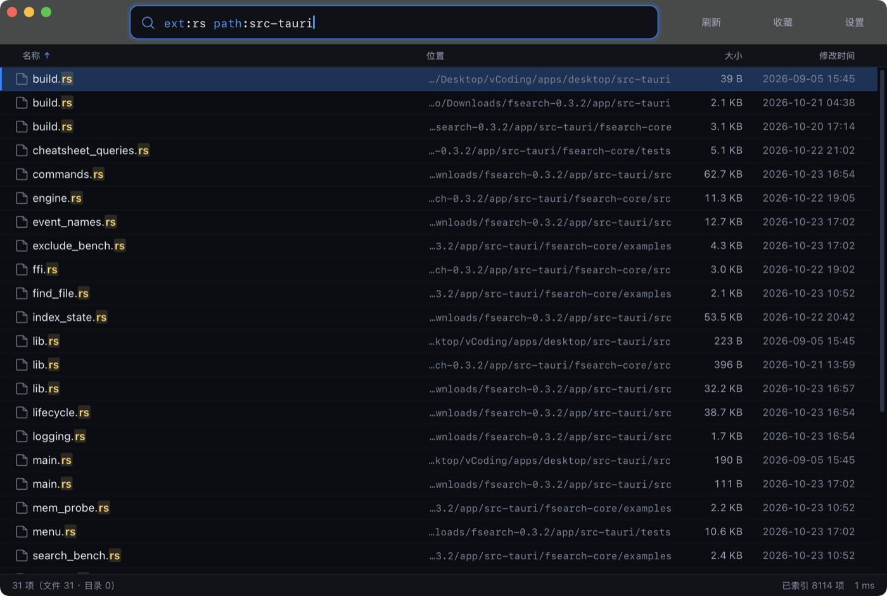
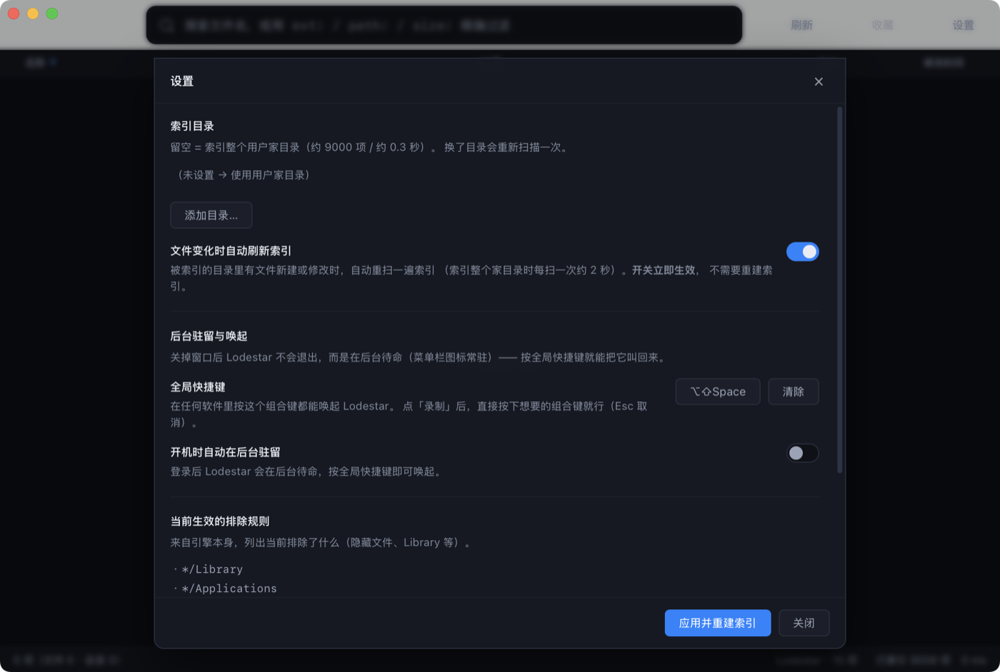
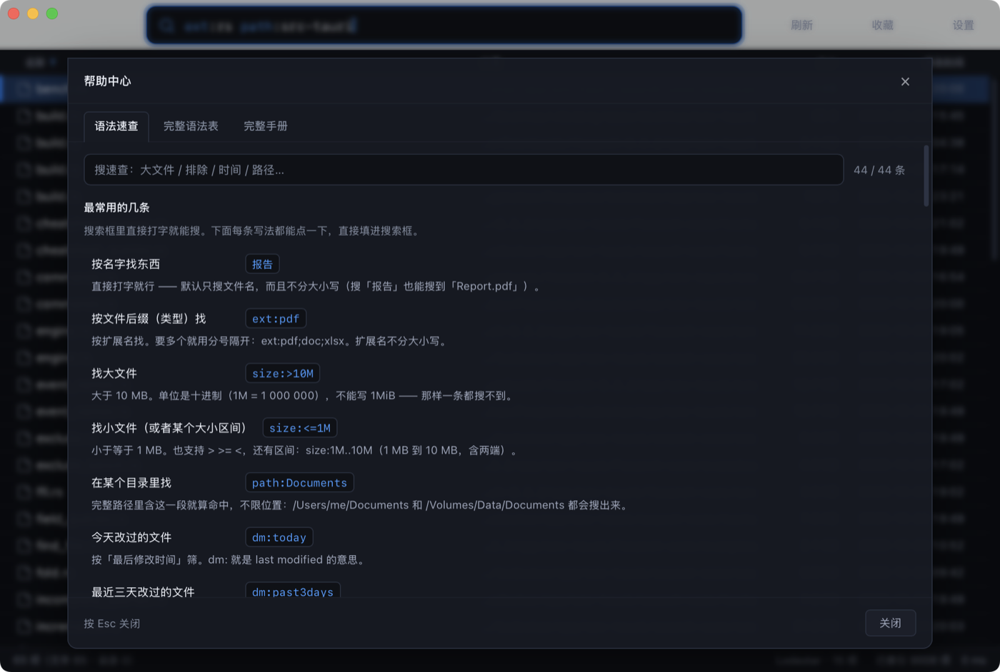
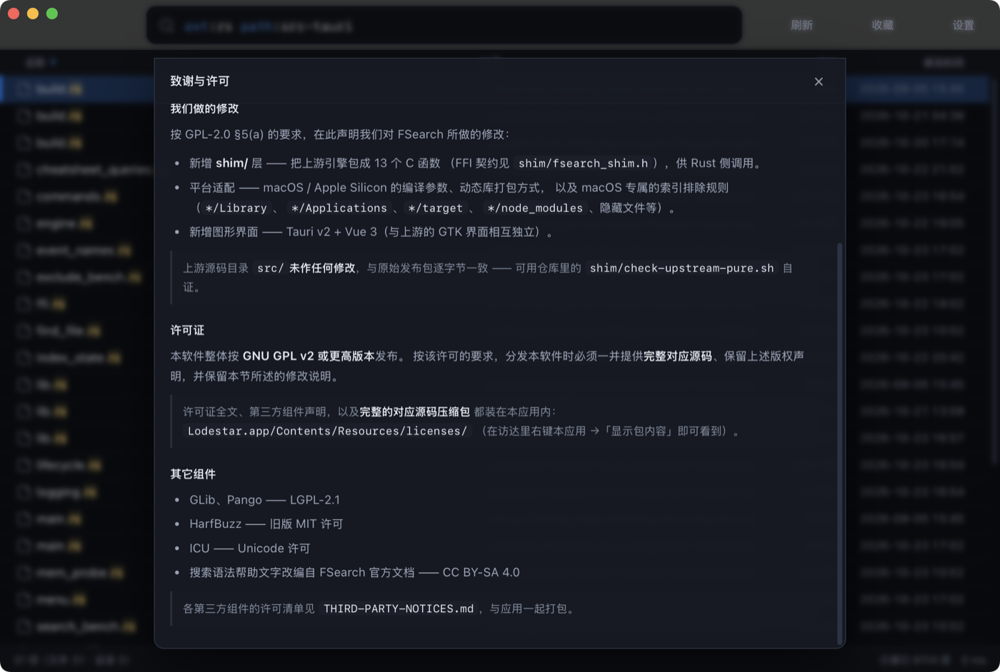

<div align="center">


# Lodestar for macOS

**一个 macOS / Apple Silicon 原生的文件搜索工具**

搜索引擎内核**完全自研** · 零第三方引擎代码 · MIT

[下载](#安装) · [功能](#功能) · [构建](#从源码构建) · [架构](#架构) · [性能](#性能实测) · [许可](#致谢与许可)

</div>

<div align="center">

**GitHub** · https://github.com/YOUR_ACCOUNT/lodestar
　|　
**Gitee（国内镜像）** · https://gitee.com/YOUR_ACCOUNT/lodestar

</div>

---

## 这是什么

Lodestar 是一个常驻菜单栏的 macOS 文件搜索工具：**按一下快捷键、打几个字，
文件就出来了**。

- **原生手感** —— Tauri v2 外壳 + WKWebView，不是 Electron，不是网页套壳
- **秒开** —— 后台常驻，全局快捷键唤起，窗口上屏约 **360 毫秒**
- **安静** —— 收起来时几乎不烧 CPU（实测 **0.10%**，见[性能](#性能实测)）
- **自包含** —— 拷到任何 Mac 上直接双击就能跑，**不拖任何第三方依赖库**（整个 app **5.9 MB**）
- **插上 U 盘也能搜** —— 外接盘自动进索引，拔掉就移除

界面是 Vue 3 写的，搜索引擎是 Rust 写的 —— **整条链路没有一个第三方搜索引擎的代码**。



> 上面是真机截图：搜索框里 `ext:` / `path:` 字段是**蓝色**，命中的 `rs` 高亮成琥珀色，
> 路径过长自动折叠成 `…/Downloads/…`，右下角状态栏显示「已索引 9008 项」——
> 旁边的「Lodestar · 15 项」是**当前挂着的那个磁盘映像**（外接卷自动进索引，见下）。

---

## 功能

### 搜索

| 能力 | 说明 |
|---|---|
| **实时搜索** | 边打字边出结果（引擎实测 **0.4 ms**） |
| **高级语法** | 字段 `ext:` `size:` `dm:`（改过时间）`contenttype:` `depth:` `parent:` `childcount:` 等；修饰符 `path:` `regex:` `folder:` `file:` `exact:` `case:` `nocase:` |
| **运算符** | `AND`（空格 / `&&`）、`OR`（\|\|）、`NOT`（`!`）、括号分组 `()` |
| **通配符** | `*` 匹配任意多个字符、`?` 匹配单个字符 |
| **转义** | 双引号 `"..."` 按字面量处理、反斜杠 `\` 转义下一个字符 |
| **语法着色** | 搜索框里字段和修饰符显示为**蓝色**、运算符**橙色**、字符串**绿色**、路径**青色**、`NOT` **红色** |
| **大小写** | 默认不区分；查询里**带大写字母就自动区分**（smart case） |
| **排序** | 点表头换排序：名称 / 位置 / 大小 / 修改时间，再点一次翻方向 |
| **分组** | 升序时目录排在前面，中间插入分隔行（写着「文件 (9)」） |
| **虚拟滚动** | 等高行虚拟滚动 + 游标分页，万级结果也不卡 |

### 界面

| 功能 | 入口 |
|---|---|
| **右键菜单** | 结果行右键：打开 / 在访达中显示 / 收藏 / 详情 |
| **预览卡** | 右键菜单 → 详情：文件名、所在目录、大小、修改时间、类型 |
| **帮助中心** | `⌘/` —— 语法速查 / 完整语法表 / 完整手册 三页 |
| **书签与最近搜索** | `⌘B` —— 最近搜索 / 查询书签 / 路径书签（后者可在访达里定位） |
| **收藏当前查询** | 标题栏「收藏」按钮 |
| **索引目录设置** | 标题栏「设置」→ 选目录 → 「应用并重建索引」 |
| **托盘菜单** | 菜单栏图标 → 打开 Lodestar / 设置 / 退出 |

<details>
<summary><b>点开看设置面板与帮助中心</b></summary>

**设置面板** —— 索引目录、自动刷新开关、全局快捷键、开机自启，以及**当前生效的排除规则**一览：



**帮助中心** —— `⌘/` 打开，三页签（语法速查 / 完整语法表 / 完整手册），速查页按「我想找什么」组织：



</details>

### 外接盘

macOS 把 U 盘、移动硬盘挂在 `/Volumes/<卷名>`。Lodestar 会**自动发现并索引**它们：

| 行为 | 说明 |
|---|---|
| **插上就进索引** | 一秒内发现并扫完，状态栏显示「U盘 · 正在索引…」 |
| **拔掉就移除** | 条目立刻消失 —— **不会**留着让你搜到已经拔掉的盘 |
| **插回来能立刻搜** | 上次的索引还在，先秒开，再后台刷新一遍 |
| **只索引本地磁盘** | 网络共享（smbfs / nfs）不会被自动索引 |

> 换索引目录时，已经插着的盘**不会被踢出索引**；
> 但如果你填了一个**不存在**的目录，会明确报错（不会悄悄改成索引 U 盘）。

### 后台常驻

- 全局快捷键唤起（默认 `⌥⌘Space`，可改）
- 关窗 = **隐藏到后台**，不是退出（进程活着，唤起约 360ms）
- **开机自启**（可关）
- 窗口收起时**主动停掉**前端状态轮询 → 后台几乎零开销
- 失焦超过 20 秒自动判空闲 → 暂停「文件变化自动更新索引」

### 索引

- 默认索引整个 `$HOME`，可自定义目录
- **FSEvents 实时监控** —— 文件新建 / 修改 / 删除后**增量更新**索引（只碰真变了的那几个路径）
- 0.8 秒防抖（一次保存只更新一次）+ 两次自动更新至少隔 0.4 秒
- **索引档按目录分文件** —— 家目录一个档、外接盘各一个档；
  插拔 U 盘**不会**把家目录的档作废
- 引擎级排除规则（**目录级剪枝** —— 整个目录不进索引，不是逐个文件过滤）：
  `*/Library`、`*/Applications`、`*/target`、`*/node_modules`、`/System*`、`/private/var*`、
  `/cores*`、`/proc`、`/sys`、`*/.Spotlight-V100`，以及所有隐藏文件与目录
- 排除判断带**前缀缓存** —— 噪声路径（agent 日志、浏览器缓存）只花一次字符串比较

---

## 安装

>  **本仓库只放源码，不放安装包。**
> 构建产物落在 `app/src-tauri/target/`，被 `.gitignore` 的 `/target/` 规则排除 ——
> 所以 clone 下来是**没有** `.app` / `.dmg` 的。
> 想要现成的包：从下面的 Releases 下载；想自己改：直接看[从源码构建](#从源码构建)。

### 直接下载

| 平台 | 下载 |
|---|---|
| **GitHub** | [Releases](https://github.com/YOUR_ACCOUNT/lodestar/releases) |
| **Gitee**（国内访问快） | [Releases](https://gitee.com/YOUR_ACCOUNT/lodestar/releases) |

>  **Release 附件需要仓库维护者手动上传**（GitHub / Gitee 都不会自动带上仓库里的构建产物）——
> 步骤见文末折叠的「维护者：发布流程」。

下载 `Lodestar.dmg` 后：

1. 双击 DMG，把 `Lodestar.app` 拖进「应用程序」
2. **首次打开会被 Gatekeeper 拦**（没有 Developer ID 签名和公证）→
   右键点 app →「打开」→ 或在「系统设置 → 隐私与安全性」里点「仍要打开」

<details>
<summary>命令行安装（绕过隔离标记）</summary>

```bash
# 从终端下载不会触发 Gatekeeper 的隔离标记
# GitHub
curl -LO https://github.com/YOUR_ACCOUNT/lodestar/releases/download/v0.1.0/Lodestar.dmg
# Gitee（国内更快）
# curl -LO https://gitee.com/YOUR_ACCOUNT/lodestar/releases/download/v0.1.0/Lodestar.dmg

hdiutil attach Lodestar.dmg
cp -R /Volumes/Lodestar/Lodestar.app /Applications/
xattr -cr /Applications/Lodestar.app   # 双保险
open /Applications/Lodestar.app
```
</details>

>  **仅支持 Apple Silicon（arm64）**。

---

## 从源码构建

### 环境要求

| 依赖 | 版本 | 说明 |
|---|---|---|
| macOS | 13+ | Ventura 及以上 |
| Xcode | 完整版 | 需要 Command Line Tools 之外的完整 Xcode |
| Rust | ≥ 1.90 | `tauri-plugin-autostart 2.7.0` 声明的 MSRV |
| Node.js | ≥ 22.12 | |
| pnpm | ≥ 9 | |

> 引擎是**纯 Rust**，**不需要** `icu4c` / `pkg-config` / GTK 那一套 —— 
> 那是上游 FSearch 的依赖，现在已经不需要了。

### 构建

```bash
# 1. 装前端依赖
pnpm --dir=app install

# 2. 跑起来
pnpm --dir=app tauri dev
```

首次 `pnpm tauri dev` 会编译 Tauri 依赖（数分钟），慢是正常的。
可以先 `cargo fetch --manifest-path app/src-tauri/Cargo.toml` 预热。

### 打包

**用仓库自带的脚本**（不要直接 `pnpm tauri build`）：

```bash
bash app/scripts/bundle-app.sh
```

产物在 `app/src-tauri/target/release/bundle/macos/`：

| 产物 | 是什么 |
|---|---|
| **`Lodestar.dmg`** | 磁盘映像 —— macOS 上分发软件的标准容器 |
| `Lodestar.app` | 应用程序包本体 |

两个都是**自包含**的：不拖任何第三方动态库，只用系统框架
（实测 `otool -L` 里的依赖全是 `/System/Library/Frameworks/…`）。

脚本每一步都有自检，末尾打印「✅ 全部自检通过」：

```
✓ rpath 里没有绝对路径
✓ 前端已嵌进二进制（custom-protocol feature 生效）
✓ 二进制只依赖系统框架（没有外部 dylib）
✓ 签名有效（codesign --verify --deep --strict）
✓ 没有 Contents/Frameworks/ 目录（没有外部 dylib 要带）
```

> **为什么必须走脚本**：`cargo build --release` 编出来的二进制**没有**
> `tauri/custom-protocol` feature → 前端不内嵌 → webview 去连 `localhost:1420`
> → **白屏，但 Rust 侧引擎照跑**，看起来像「启动了」。

---

## 性能实测

在 Apple Silicon（M 系列）上实测，索引整个 `$HOME`（**8,993 项**）：

| 状态 | CPU | 内存 |
|---|---|---|
| **收起来（后台常驻）** | **0.10%**（主进程；窗口隐藏、状态轮询已停） | ~95 MB |
| **窗口开着** | **0.3% ~ 0.4%** | ~95 MB |
| 唤起到窗口上屏 | ~360 ms | — |

> CPU 用 `ps` 的 **CPU 时间增量 ÷ 墙钟** 量（不是 `top` 那个开机以来的平均值），
> 取的是**主进程**（WebKit 的三个辅助进程另算）。
> 内存用 macOS 自带的 `footprint` 量，取**四个进程之和**
> （主进程 + WebKit 的 GPU / 渲染 / 网络三个辅助进程 ——
> 它们是 XPC 服务，`pgrep -P` 认不出来，得按启动时刻认）。
> **窗口藏起来不会让内存降下来** —— webview 的内存不会因为窗口不可见就还给系统。
>
> 唤起延迟的口径：**按下全局快捷键 → 窗口出现在屏幕上**（`CGWindowList` 里能看到），
> 实测 342~373 ms（七轮，中位数 359 ms）。这是「上屏」时刻，不含人把手放回键盘上。
>
> **数字随机器状态浮动**：别的程序疯狂写文件时，文件监控的排除判断会顶上来
> （噪声路径每秒几百条），隐藏态能到 0.4%，窗口开着时能从 0.6% 涨到 1.4%。
> 索引整个家目录时，建议把设置里的「文件变化时自动更新索引」关掉。

**为什么后台几乎不烧 CPU**：窗口收起来之后界面根本看不见，那就没必要继续刷新状态栏
—— 应用会**主动停掉**状态轮询，窗口一回来再重新开上。

**引擎多快**（2026-10-25 实测）：

| 操作 | 实测 |
|---|---|
| 冷启动读索引档 | **3.8 ms**（8,993 项） |
| 全量扫描（建索引） | **109 ms**（8,585 项，热缓存） |
| 搜索匹配 `*`（引擎内部） | **0.40 ms** |
| 搜索匹配 `ext:pdf`（引擎内部） | **0.06 ms** |
| 索引落盘（3.2 MB，含 fsync） | **10.5 ms** |
| 增量更新：改 1 个文件 | **0.01 ms**（落盘另算） |
| 增量更新：改 100 个文件 | **0.38 ms**（**一次**更新） |
| 外接卷监控（每秒一次 `getfsstat`） | **6.7 µs**（可忽略） |

> **这些数字是「同机同树交替 A/B」测出来的** —— 基线版本与当前版本**轮流各测一轮**。
> 单次测量在这台机器上噪声能到 4 倍（别的程序在写文件、构建在跑），
> **绝对值会随机器状态漂移，相对比较才有意义**。

### 体积

**装到机器上有多小**（2026-10-25 实测）：

| 东西 | 大小 |
|---|---|
| `Lodestar.dmg`（下载物） | **4.4 MB** |
| `Lodestar.app`（拖进 /Applications 后） | **5.9 MB** |
| ├ 二进制本体 | 4.9 MB |
| ├ Resources（图标 + 许可证） | 1.0 MB |
| └ Info.plist + 签名 | 8 KB |
| 索引档（约 9000 项，落盘） | 3.2 MB |

**仓库有多小**（同一个提交实测）：

| 项 | 大小 |
|---|---|
| 源码净重（去掉 `.git` / `target` / `node_modules`） | **7.9 MB / 164 个文件** |
| ├ 搜索引擎内核 `search-core/` | 388 KB |
| ├ Rust 后端 `src-tauri/src/` | 564 KB |
| ├ 前端 `app/src/` | 496 KB |
| ├ 文档 + 4 张截图 | 2.1 MB |
| └ 原型设计图 `prototype/` | 1.8 MB |
| `.git` 历史（40 提交 / 3 分支） | 11 MB |
| **clone 下来实际要拉** | **≈ 19 MB** |

> 开发机上的工作区是 124 MB，但其中 **116 MB 是 `node_modules`**（pnpm 装的依赖）——
> 这不是项目本身的重量，clone 的人装完依赖也一样。

**内存花在哪**（`footprint` 实测，四个进程之和）：

| 进程 | footprint | 说明 |
|---|---|---|
| 主进程（Rust 引擎 + 命令层） | 30 MB | 其中**引擎加索引只占 3.2 MB** |
| WebKit GPU 进程 | 21 MB | WebKit 的图形合成 |
| WebKit 渲染进程 | 40~45 MB | 页面 DOM + 绘制表面（图形缓冲约 22 MB） |
| WebKit 网络进程 | 5.9 MB | |
| **合计** | **≈ 95 MB** | |

> **那 ~70 MB 全是 WKWebView 的底座**（框架页 + 渲染进程 + 绘制表面），
> 不是 Lodestar 自己的代码 —— **引擎加索引本身只占 3.2 MB**。
> 想再压下去，就得把整个前端换成原生 AppKit 界面重写一遍。
>
> 窗口藏起来**不会**让内存降下来（实测显隐两态都是 95 MB）——
> webview 的内存不会因为窗口不可见就还给系统。
> 反复开关面板也不会累积：实测连开 5 次设置面板，合计稳定在 92~94 MB。

**一句话**：磁盘上真轻（5.9 MB，不拖任何第三方动态库），
CPU 上真轻（后台 0.10%）；
**那 95 MB 内存里约 70 MB 是 WebView 的价，不是这个项目自己的重量**。

---

## 架构

```
lodestar/
├── app/                        Tauri v2 + Vue 3 应用
│   ├── src/                    前端（Vue 3 + TypeScript + Vite）
│   └── src-tauri/
│       ├── src/                Rust 后端（命令层 / 文件监控 / 卷监控 / 生命周期 / 设置）
│       └── search-core/        ★ 自研搜索引擎内核（纯 Rust，不依赖 Tauri）
│           ├── scan.rs         并行遍历 + 排除剪枝
│           ├── store.rs        索引落盘（每根一个文件）
│           ├── query.rs        查询语法（词法 / 语法 / 匹配）
│           ├── fold.rs         Unicode 折叠（索引期做一次）
│           ├── mime.rs         扩展名 → MIME 类型表（`contenttype:` 用）
│           ├── types.rs        公共类型（条目 / 元信息 / 结果）
│           ├── engine.rs       索引 / 排序 / 分页 / 高亮
│           ├── incremental.rs  增量更新（脏路径 → 就地改索引）
│           ├── exclude.rs      排除规则（唯一真相）
│           ├── syntax.rs       语法表（唯一真相）
│           └── worker.rs       串行搜索线程
├── docs/
│   ├── USER-GUIDE.md           用户手册（应用内「帮助 → 完整手册」显示的就是它）
│   ├── PROJECT-HANDOFF.md      项目交接文档
│   └── screenshots/            README 里用的真机截图
├── prototype/                  HTML 原型（交互设计稿）
└── AGENTS.md                   项目硬约束与踩坑记录
```

### 数据流

```
用户输入
   ↓  Tauri IPC
Rust 命令层 (commands.rs)
   ↓  mpsc 通道（★ 所有搜索与重扫严格串行）
search_core::Searcher ── 单线程 worker ──┐
   ↓                                     │
search_core::Engine（索引 + 查询 + 排序）  │
   ↓                                     │
search_core::store（每根一个档）          │
   ↓                                     │
磁盘 ──── FSEvents ──► 增量更新 ──────────┘
```

**为什么串行**：引擎的视图是有状态的 —— `page()` 读的是上一次 `search()` 留下的视图，
并发请求会读到别人的视图。「新搜索覆盖旧搜索」由前端的序列号负责。

### 目录导航

| 路径 | 内容 |
|---|---|
| `app/README.md` | 开发文档：架构细节、设置持久化、踩坑记录 |
| `docs/USER-GUIDE.md` | 完整用户手册（语法详解、快捷键总表、FAQ） |
| `docs/PROJECT-HANDOFF.md` | 项目交接文档（背景、决策、里程碑） |
| `AGENTS.md` | 项目硬约束与性能测量方法 |

---

<!-- 锚点约定：被内链引用的标题一律【不含标点】。
     GitHub(cmark-gfm) 会把全角冒号去掉，Gitee(showdown 系) 会保留，
     两平台 slug 不一致 —— 详见 AGENTS.md「跨平台锚点」条目。 -->
## 设计原则

**搜索引擎内核完全自研** —— 引擎是这个项目的全部价值，
用别人开源的引擎意味着：速度受制于人、体积被依赖拖着走、许可被上游绑住。

早期版本确实用过上游 FSearch 的 C 引擎（GPL-2.0-or-later），
2026-10-23 起整体替换掉了 —— 现在仓库里**一行上游代码都没有**，
GPL 义务随之消失，许可回到 MIT。

自研换来了什么：

| | 上游 C 引擎（GPL） | 现在（自研，MIT） |
|---|---|---|
| 体积 | **60 MB**（ICU 34 MB + 随包分发的完整对应源码 13 MB） | **5.9 MB** |
| 许可 | GPL-2.0-or-later（衍生作品） | **MIT** |
| 冷启动 | 300~450 ms（每次全量扫描） | **3.8 ms**（读索引档） |
| 全量扫描 | 74.6 ms | **109 ms**（8,585 项，热缓存） |
| 查询延迟 | 2.6 ms | **0.38 ms** |
| 实时更新 | 300 ms+（全量重扫） | **0.38 ms**（100 个文件，一次增量更新） |
| 依赖 | **18 个** Homebrew 依赖（glib / pango / harfbuzz / icu…），全要嵌进 `.app` | **零**（只用系统框架） |

> 对比口径：同一棵 `$HOME` 树（8,948 项）、命中 55% 的查询 —— 上游 2.6 ms，自研 0.38 ms；
> 冷启动 300~450 ms 对应上游的「每次都全量扫描」，
> 自研改成「读索引档 3.8 ms 就绪，变了再增量更新」。

**怎么证明没有第三方引擎代码**：

```bash
# 仓库里没有上游的 C 源码目录
ls src shim build-shim* 2>/dev/null || echo "没有"

# 许可声明
cat LICENSE          # MIT
cat THIRD-PARTY-NOTICES.md   # 只有常规 crate / npm 依赖
```

---

## 测试

```bash
# 每条都【在仓库根执行】
cargo test --manifest-path app/src-tauri/Cargo.toml     # Rust：249 项
pnpm --dir=app vitest run                                # 前端（vitest）：278 项
bash app/scripts/bundle-app.sh                           # 打包 + 自检
```

**合计 527 项**，两套语言 + 打包自检：

| 套件 | 跑在哪 | 护的是什么 |
|---|---|---|
| Rust 单元测试 | `app/src-tauri/src/**` 的 `#[cfg(test)]` | 索引状态机、托盘、快捷键、watcher 契约、卷监控编排、重扫去抖决策 |
| Rust 集成护栏 | `app/src-tauri/tests/*.rs` | 菜单契约、z-index 层级、语法表、用户手册、watcher 契约、**外接卷契约** |
| 引擎集成护栏 | `app/src-tauri/search-core/tests/*.rs` | 索引档格式、增量更新与全量重扫的等价性、字段查询、**根目录增删** |
| 前端单测 | `app/src/**/*.test.ts` | 快捷键解析、分词、设置读写、书签、语法高亮、状态栏 |

---

## 已知限制

- **只支持 Apple Silicon**（arm64）
- **没有 Developer ID 签名与公证** —— 首次打开需在设置中选择“仍要打开”
- **没有自动更新**（updater）—— 需要签名密钥，依赖 Developer ID
- **外接盘的挂载点变了就当新盘** —— 在访达里改卷名会让它重新全量扫一次
- `path:` 是**子串匹配**，引擎**不做 `~` 展开** —— `path:~` 恒 0 条，要用绝对路径
- 空查询被短路成 0 条（不进引擎）—— 想「匹配全部」用 `*`
- 索引整个 `$HOME` 时建议**关掉自动更新** —— 别的程序一直写文件会反复触发更新
- 网络共享**不会**被自动索引（只索引本地外接卷）

更完整的说明见 [`docs/USER-GUIDE.md`](docs/USER-GUIDE.md)。

---

## 致谢与许可

### 第三方组件

Lodestar 的**全部代码都是自己写的**（包括搜索引擎内核），
第三方部分只有常规的构建期依赖 —— Tauri、Vue、notify、regex、unicode-normalization 等，
完整清单见 [`THIRD-PARTY-NOTICES.md`](THIRD-PARTY-NOTICES.md)，应用内也能看：



### 本项目

macOS 界面层、搜索引擎内核、构建脚本与文档由 **秃然** 编写。

---

## License

本项目以 **MIT** 许可发布，详见 [`LICENSE`](LICENSE)。

---

<details>
<summary><b>维护者：发布流程（怎么把 .dmg 挂到 Releases 上）</b></summary>

仓库里**不含** `Lodestar.app` / `Lodestar.dmg` —— 它们在
`app/src-tauri/target/release/bundle/macos/`，被 `/target/` 规则排除。
分发靠 **Releases 附件**，所以每次发版都要手动传一次。

### 1. 打出产物

```bash
bash app/scripts/bundle-app.sh
```

脚本每一步都有自检，末尾必须打印 `✅ 全部自检通过` ——
其中「前端已嵌进二进制」这条是**白屏的判据**（详见[打包](#打包)）。

| 产物 | 大小 |
|---|---|
| `Lodestar.dmg` | 约 **4.4 MB** |
| `Lodestar.app` | 约 **5.9 MB** |

### 2. 打标签并推送

```bash
git tag -a v0.1.0 -m "v0.1.0"
git push origin v0.1.0        # 需要先给仓库加远端
```

### 3. 传附件

```bash
# GitHub
gh release create v0.1.0 \
  app/src-tauri/target/release/bundle/macos/Lodestar.dmg \
  --title "v0.1.0" --notes "见 CHANGELOG"

# Gitee（用它的 API 或网页上传）
```

> **不要**把 `Lodestar.app` 直接塞进仓库 —— 它会被 `.gitignore` 挡住，
> 而且仓库会平白多几 MB 二进制。

</details>
